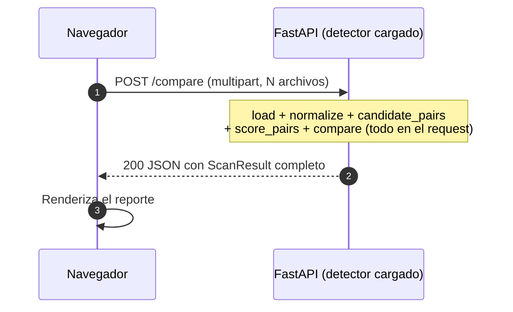
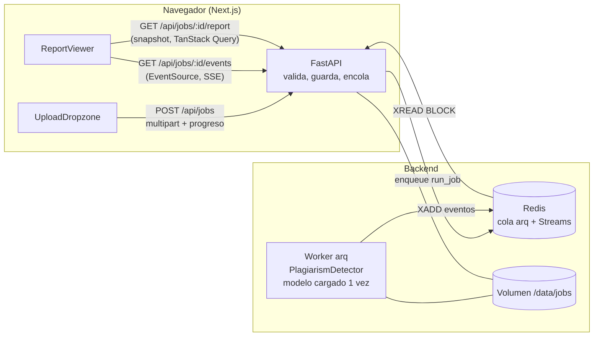
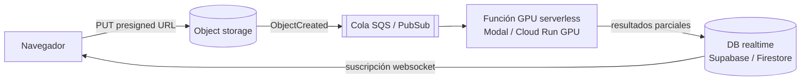
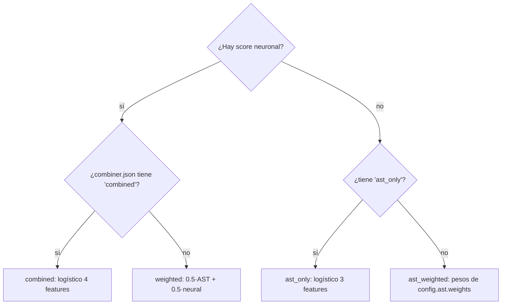

# CodePlag Web: subida de archivos y reporte dentro de la página

> **Para quién:** equipo junior que va a construir la interfaz web de CodePlag.
> **Qué resuelve:** el usuario arrastra archivos de código, el sistema los compara con el
> detector existente (AST + red neuronal + combiner) y el reporte aparece **en la misma
> página, sin recargar**, llenándose en vivo conforme llegan resultados parciales.
> **Base:** todo se apoya en el código que ya existe en `src/codeplag/`. No se reescribe el
> detector; se envuelve.

> **Estado: implementado** en la rama `feat/web-report-viewer`. Los fragmentos de este
> documento explican el diseño y están simplificados; **la fuente de verdad es el código**.
> Ver §12 para el mapa documento → archivos y las diferencias con este texto.

---

## 0. TL;DR (decisiones)

| Tema | Decisión | Por qué (una línea) |
| --- | --- | --- |
| Stack de UI | **Opción B**: Next.js 14 + TypeScript + Tailwind + shadcn/ui + TanStack Query + Plotly.js + AG-Grid + react-pdf | Necesitamos SSE, streaming parcial, drag & drop con progreso real y CI de producción; Streamlit no hace bien ninguna de las cuatro. |
| Backend | **FastAPI** (Python 3.12) que importa `codeplag` directamente | El detector, el modelo y el combiner ya son Python; cero duplicación de lógica de detección. |
| Ejecución | **Jobs asíncronos** con `arq` + Redis (Arquitectura 2) | Un scan con modelo neuronal tarda de segundos a minutos; no cabe en un request HTTP. |
| Tiempo real | **SSE** (Server-Sent Events) respaldado por **Redis Streams** | Flujo unidireccional servidor→cliente, reconexión automática con `Last-Event-ID` y re-envío sin pérdidas. |
| "Combiner" | Dos piezas: **(1)** `Combiner.score` (ya existe, fusiona AST+neural) y **(2)** `combineResults` (nuevo, fusiona eventos parciales en el estado del reporte). Ambos en Python y TS con tests de paridad. | El primero calcula el score; el segundo hace que el streaming sea idempotente y sin conflictos. |

**Cuándo sí usar la Opción A (Streamlit):** si sólo se necesita una demo interna para la
presentación del reto en menos de 3 días. Se puede hacer en ~150 líneas llamando a
`PlagiarismDetector.scan()` y pintando `st.tabs`, pero sin streaming real ni reconexión. No es
la base para producción.

---

## 1. Opción A vs Opción B

| Criterio | A: Streamlit/Gradio + Plotly | B: Next.js + FastAPI |
| --- | --- | --- |
| Tiempo a primera demo | 1 día | 4 a 6 días |
| Streaming de resultados parciales | Re-ejecuta todo el script en cada interacción; streaming se simula con `st.empty()` en el mismo proceso | SSE nativo, cada par aparece al terminar |
| Progreso de subida (bytes) | No (el uploader no expone progreso) | Sí (`XMLHttpRequest.upload.onprogress`) |
| Concurrencia de usuarios | Un proceso Python por sesión; el modelo de ~500 MB se carga por sesión si no se cachea bien | Modelo cargado **una vez por worker**; la web no toca el modelo |
| Tablas con filtros | `st.dataframe` (básico) | AG-Grid (filtros por columna, orden, export CSV) |
| Testabilidad | Difícil (UI y lógica mezcladas) | API probada con pytest, UI con Vitest/Playwright |
| Curva para juniors | Muy baja | Media (dos lenguajes), compensada por contratos tipados |

**Elegida: B.** El costo extra está en el día 1; a partir de ahí cada requisito (SSE, filtros,
progreso, CI) es una pieza estándar en vez de un parche.

---

## 2. Tres arquitecturas, deconstruidas

### 2.1 Arquitectura 1: monolito síncrono



- **Cómo funciona:** el endpoint llama `PlagiarismDetector.scan()` y devuelve el JSON.
- **A favor:** 1 servicio, ~80 líneas, trivial de depurar.
- **En contra:** con modelo neuronal en CPU un par cuesta ~78 ms p50 / ~480 ms p95
  (`docs/results/efficiency.json`); 50 archivos con prefiltro ya son decenas de segundos, y los
  proxies cortan a los 30–60 s. Sin resultados parciales. Un request lento bloquea un worker de
  Uvicorn y el modelo compite con la API por CPU/GPU.
- **Úsala para:** comparar exactamente 2 archivos (≤ 1 s). Por eso el diseño final conserva un
  atajo síncrono para `N = 2` (ver §4.2).

### 2.2 Arquitectura 2: API + cola de jobs + SSE (**elegida**)



- **Cómo funciona:** la API valida y guarda los archivos, crea un job y responde `202` con el
  `jobId` en milisegundos. El worker ejecuta el scan **par por par** y publica cada resultado
  como evento en un Redis Stream (`job:{id}:events`). La API reenvía ese stream como SSE. El
  snapshot (`GET /report`) es simplemente el *fold* de todos los eventos con `combineResults`.
- **A favor:** resultados parciales reales; reconexión sin pérdida (el stream es un log);
  la API nunca carga PyTorch; escalar = más réplicas de `worker`; reintentos idempotentes.
- **En contra:** 4 servicios (web, api, worker, redis); hay que pensar en orden/duplicados de
  eventos (resuelto en §6); Redis es estado que hay que expirar (TTL 24 h).

### 2.3 Arquitectura 3: event-driven / serverless



- **A favor:** escala a cero (sin costo en reposo), subidas grandes directo a storage,
  GPU sólo cuando hay trabajo.
- **En contra:** arranque en frío de 10–40 s al cargar UniXcoder; vendor lock-in; local-dev
  difícil (emuladores); los datos de alumnos salen a un tercero, lo cual en un contexto
  universitario exige revisión de privacidad. Demasiadas piezas para un equipo junior.
- **Úsala si:** el volumen pasa a miles de entregas por semana con picos (fin de semestre).
  El diseño elegido migra a esto cambiando sólo el transporte (los eventos y el reducer son
  los mismos).

### 2.4 Resumen de tradeoffs

| | Arq. 1 síncrona | **Arq. 2 jobs + SSE** | Arq. 3 serverless |
| --- | --- | --- | --- |
| Latencia primer resultado | = tiempo total | ~1 par (< 1 s) | arranque en frío + 1 par |
| Resultados parciales | No | **Sí** | Sí |
| Tolerancia a fallos | Request perdido | Reintento + reanudación | Reintento de la plataforma |
| Servicios a operar | 1 | 4 | 3 gestionados |
| Costo en reposo | Bajo | Bajo (1 VM) | ~0 |
| Dev local | Trivial | `docker compose up` | Emuladores |
| Privacidad de datos | Local | Local | Terceros |

---

## 3. Contrato de API (fuente de verdad)

Base: `/api`. Todo JSON en `camelCase` hacia el frontend (Pydantic con `alias_generator`).

| Método | Ruta | Descripción | Respuesta |
| --- | --- | --- | --- |
| `POST` | `/jobs` | Multipart `files[]` (2–200 archivos). Valida y encola. | `202 {jobId, status, deduplicated}` |
| `GET` | `/jobs/{id}` | Estado ligero (para polling de respaldo). | `{status, done, total, flagged}` |
| `GET` | `/jobs/{id}/events` | SSE. Respeta header `Last-Event-ID`. | `text/event-stream` |
| `GET` | `/jobs/{id}/report` | Snapshot completo (fold de eventos). | `ReportState` |
| `GET` | `/jobs/{id}/files/{fileId}` | Código fuente para la vista lado a lado. | `text/plain` |
| `GET` | `/jobs/{id}/report.pdf` | PDF generado al completar (ReportLab). | `application/pdf` |
| `GET` | `/combiner` | Parámetros del combiner activo (para "what-if" en el cliente). | `CombinerParams` |
| `GET` | `/healthz` | Liveness/readiness (Redis + modelo). | `{ok, model, combiner}` |

### 3.1 Eventos (unión discriminada por `type`)

Cada evento lleva `seq` (entero estrictamente creciente por job, empieza en 1). En SSE se
envía como `id: <seq>`, así el navegador lo devuelve en `Last-Event-ID` al reconectar.

```ts
// web/src/lib/types.ts — espejo exacto de api/schemas.py
export type Verdict = "likely_plagiarism" | "unlikely_plagiarism";

export interface CombinerParams {
  name: string;                       // "combined" | "ast_only" | "weighted" | "ast_weighted"
  method: "logistic" | "weighted";
  features: string[];                 // orden de coef
  coef: number[];
  intercept: number;
  threshold: number;                  // calibrado en val con FPR ≤ 5 %
  version: string;                    // sha256 corto del JSON del combiner
}

export interface FileRef { fileId: string; name: string; language: string; sha256: string }

export interface MatchRegion { linesA: [number, number]; linesB: [number, number]; size: number; node: string }

export type JobEvent =
  | { type: "job.started"; seq: number; jobId: string; files: FileRef[]; totalPairs: number;
      candidatePairs: number; prefilter: string; combiner: CombinerParams; modelVersion: string | null }
  | { type: "pair.partial"; seq: number; pairKey: string; fileA: string; fileB: string;
      stage: "ast"; astFeatures: Record<string, number>; astScore: number }
  | { type: "pair.scored"; seq: number; pairKey: string; fileA: string; fileB: string;
      stage: "final"; combinerVersion: string; astFeatures: Record<string, number>; astScore: number;
      neuralScore: number | null; score: number; threshold: number; verdict: Verdict;
      detector: string; matches: MatchRegion[]; warnings: string[] }
  | { type: "progress"; seq: number; done: number; total: number }
  | { type: "log"; seq: number; level: "debug" | "info" | "warning" | "error"; message: string; ts: string }
  | { type: "job.completed"; seq: number; seconds: number; flagged: number }
  | { type: "job.failed"; seq: number; error: string; retryable: boolean };
```

`pairKey` = `sha256(min(hA,hB) + ":" + max(hA,hB))[:16]` sobre los hashes de contenido. Así
`(A,B)` y `(B,A)` son el mismo par, y dos archivos idénticos con distinto nombre se detectan
igual.

---

## 4. Backend (Python)

Estructura nueva (no toca `src/codeplag/`):

```
web/
  api/
    __init__.py
    settings.py      # env vars (pydantic-settings)
    schemas.py       # modelos Pydantic = contrato §3
    events.py        # Redis Streams: publish / replay / tail
    reducer.py       # combine_results (§6, versión Python)
    streaming.py     # iter_scan: scan par por par como generador de eventos
    validation.py    # validación de archivos subidos
    main.py          # FastAPI app y rutas
    worker.py        # tarea arq run_job
  tests/
```

### 4.1 `settings.py`

```python
"""Configuración de la capa web. Todo sale de variables de entorno (ver §8)."""
from pydantic_settings import BaseSettings, SettingsConfigDict


class WebSettings(BaseSettings):
    model_config = SettingsConfigDict(env_prefix="CODEPLAG_WEB_", env_file=".env")

    redis_url: str = "redis://redis:6379/0"
    jobs_dir: str = "/data/jobs"              # volumen compartido api <-> worker
    max_files: int = 200
    max_file_bytes: int = 512 * 1024         # 512 KB por archivo de código es generoso
    max_total_bytes: int = 20 * 1024 * 1024
    job_ttl_seconds: int = 24 * 3600         # se borran datos de alumnos al día
    cors_origins: list[str] = ["http://localhost:3000"]
    sync_max_files: int = 2                  # atajo síncrono (Arq. 1) para comparar 2 archivos
    neural_batch: int = 32                   # pares por lote neuronal antes de emitir eventos


settings = WebSettings()
```

### 4.2 `validation.py`

```python
"""Validación de archivos subidos. Nunca se ejecuta el código: tree-sitter sólo lo parsea."""
from __future__ import annotations

import hashlib
from dataclasses import dataclass
from pathlib import PurePath

from fastapi import HTTPException, UploadFile

from codeplag.ast_analysis.parser import EXTENSIONS  # .py .pyw .java .js .mjs .cjs

from .settings import settings


@dataclass(frozen=True)
class ValidFile:
    name: str        # sólo el basename, sin rutas (evita path traversal)
    language: str
    code: str
    sha256: str


async def validate_uploads(files: list[UploadFile]) -> list[ValidFile]:
    if not 2 <= len(files) <= settings.max_files:
        raise HTTPException(422, f"Sube entre 2 y {settings.max_files} archivos.")
    out: list[ValidFile] = []
    total = 0
    for f in files:
        name = PurePath(f.filename or "").name
        suffix = PurePath(name).suffix.lower()
        if suffix not in EXTENSIONS:
            raise HTTPException(415, f"{name}: extensión no soportada ({', '.join(sorted(EXTENSIONS))}).")
        # Lee como máximo max_file_bytes + 1 para detectar exceso sin cargar archivos enormes.
        raw = await f.read(settings.max_file_bytes + 1)
        if len(raw) > settings.max_file_bytes:
            raise HTTPException(413, f"{name}: supera {settings.max_file_bytes // 1024} KB.")
        total += len(raw)
        if total > settings.max_total_bytes:
            raise HTTPException(413, "El total de archivos excede el límite.")
        try:
            code = raw.decode("utf-8")
        except UnicodeDecodeError:
            raise HTTPException(422, f"{name}: no es texto UTF-8.") from None
        out.append(ValidFile(name, EXTENSIONS[suffix], code, hashlib.sha256(raw).hexdigest()))
    return out
```

### 4.3 `streaming.py`: el scan como generador de eventos

`PlagiarismDetector.scan()` devuelve todo al final. Para streaming reusamos sus métodos públicos
(`from_code`, `candidate_pairs`, `scorer`, `compare`) en el mismo orden, pero emitiendo eventos:

```python
"""Scan incremental: misma lógica que PlagiarismDetector.scan(), pero emite eventos por par."""
from __future__ import annotations

import hashlib
from collections.abc import Iterator
from typing import Any

from codeplag.ast_analysis.tree_distance import compare_normalized
from codeplag.similarity.detector import PlagiarismDetector, SourceFile

from .validation import ValidFile


def pair_key(sha_a: str, sha_b: str) -> str:
    """Clave canónica e independiente del orden para un par de archivos."""
    lo, hi = sorted((sha_a, sha_b))
    return hashlib.sha256(f"{lo}:{hi}".encode()).hexdigest()[:16]


def iter_scan(
    det: PlagiarismDetector,
    files: list[ValidFile],
    skip: set[str] = frozenset(),   # pairKeys ya terminados (reanudación tras reintento)
    neural_batch: int = 32,
) -> Iterator[dict[str, Any]]:
    """Genera eventos *sin* seq; el publicador (events.py) asigna seq al escribir en Redis."""
    sources: list[SourceFile] = [det.from_code(f.code, f.language, f.name) for f in files]
    candidates, method = det.candidate_pairs(sources)
    pairs = [p for p in sorted(candidates)
             if pair_key(files[p[0]].sha256, files[p[1]].sha256) not in skip]
    scorer = det.scorer
    combiner = det.combiner(scorer is not None)
    yield {"type": "job.started", "files": [...], "totalPairs": len(files) * (len(files) - 1) // 2,
           "candidatePairs": len(candidates), "prefilter": method,
           "combiner": combiner_params(combiner), "modelVersion": det.settings.neural.checkpoint_name if scorer else None}
    yield {"type": "log", "level": "info",
           "message": f"{len(files)} archivos, {len(candidates)} pares candidatos ({method})."}

    done = len(candidates) - len(pairs)          # los saltados cuentan como hechos
    for start in range(0, len(pairs), neural_batch):
        batch = pairs[start:start + neural_batch]
        # 1) Fase AST: barata, se emite de inmediato como resultado parcial.
        ast = {}
        for i, j in batch:
            cmp = compare_normalized(sources[i].normalized, sources[j].normalized, det.settings.ast)
            ast[(i, j)] = cmp
            yield {"type": "pair.partial", "stage": "ast",
                   "pairKey": pair_key(files[i].sha256, files[j].sha256),
                   "fileA": files[i].name, "fileB": files[j].name,
                   "astFeatures": cmp.features, "astScore": cmp.score}
        # 2) Fase neuronal: por lote (la GPU/CPU es eficiente en lotes).
        neural = {}
        if scorer is not None:
            scores = scorer.score_pairs([(sources[i].code, sources[j].code) for i, j in batch])
            neural = {p: float(s) for p, s in zip(batch, scores, strict=True)}
        # 3) Combiner: mismo camino que el CLI -> mismos números que el CLI.
        for i, j in batch:
            report = det.compare(sources[i], sources[j], neural.get((i, j)), ast[(i, j)])
            d = report.to_dict()
            yield {"type": "pair.scored", "stage": "final",
                   "pairKey": pair_key(files[i].sha256, files[j].sha256),
                   "combinerVersion": combiner_version(combiner), **camelize(d)}
        done += len(batch)
        yield {"type": "progress", "done": done, "total": len(candidates)}
```

> `combiner_params`, `combiner_version` (sha256 del JSON de `asdict(combiner)`) y `camelize` son
> helpers de 5 líneas en `schemas.py`. El `[...]` de `files` es la lista `FileRef`.

**Punto clave para juniors:** el score final se calcula con `det.compare(...)`, la misma función
que usa `codeplag compare`. Si la web y el CLI dan números distintos, es un bug de la web.

### 4.4 `events.py`: Redis Streams con `seq` propio

```python
"""Log de eventos por job sobre Redis Streams. ID de stream = 0-<seq> => orden total y replay."""
from __future__ import annotations

import json
from collections.abc import AsyncIterator

from redis.asyncio import Redis

from .settings import settings


def _key(job_id: str) -> str:
    return f"job:{job_id}:events"


class EventLog:
    def __init__(self, redis: Redis, job_id: str) -> None:
        self.r, self.job_id, self.key = redis, job_id, _key(job_id)

    async def last_seq(self) -> int:
        last = await self.r.xrevrange(self.key, count=1)
        return int(last[0][0].decode().split("-")[1]) if last else 0

    async def publish(self, event: dict, seq: int) -> None:
        """Escribe con ID explícito 0-<seq>. Redis rechaza IDs no crecientes: protege contra
        dos workers escribiendo el mismo job (el segundo falla en vez de duplicar)."""
        event = {**event, "seq": seq, "jobId": self.job_id}
        await self.r.xadd(self.key, {"e": json.dumps(event)}, id=f"0-{seq}")
        await self.r.expire(self.key, settings.job_ttl_seconds)

    async def replay(self, after_seq: int = 0) -> list[dict]:
        rows = await self.r.xrange(self.key, min=f"(0-{after_seq}", max="+")
        return [json.loads(fields[b"e"]) for _, fields in rows]

    async def tail(self, after_seq: int) -> AsyncIterator[dict]:
        """Replay desde after_seq y luego bloquea esperando eventos nuevos."""
        last_id = f"0-{after_seq}"
        while True:
            resp = await self.r.xread({self.key: last_id}, block=15_000, count=100)
            if not resp:
                yield {"type": "_heartbeat"}          # mantiene viva la conexión tras proxies
                continue
            for entry_id, fields in resp[0][1]:
                last_id = entry_id.decode()
                ev = json.loads(fields[b"e"])
                yield ev
                if ev["type"] in ("job.completed", "job.failed"):
                    return
```

### 4.5 `worker.py`: tarea idempotente y reanudable

```python
"""Worker arq. Carga el modelo UNA vez por proceso y ejecuta jobs par por par."""
from __future__ import annotations

import json
import time
from pathlib import Path

from arq.connections import RedisSettings

from codeplag.core.config import load_settings
from codeplag.similarity.detector import PlagiarismDetector

from .events import EventLog
from .reducer import combine_many, initial_state
from .settings import settings
from .streaming import iter_scan
from .validation import ValidFile


async def startup(ctx: dict) -> None:
    det = PlagiarismDetector(load_settings())
    _ = det.scorer                     # fuerza la carga del checkpoint al arrancar, no en el 1er job
    ctx["detector"] = det


async def run_job(ctx: dict, job_id: str) -> None:
    log = EventLog(ctx["redis"], job_id)
    # Reanudación: si es un reintento, reconstruimos el estado y saltamos pares terminados.
    previous = await log.replay()
    state = combine_many(initial_state(job_id), previous)
    if state["status"] in ("completed", "failed"):
        return                                         # idempotente: nada que hacer
    seq = await log.last_seq()
    skip = {k for k, p in state["pairs"].items() if p["stage"] == "final"}

    manifest = json.loads((Path(settings.jobs_dir) / job_id / "manifest.json").read_text())
    files = [ValidFile(**m, code=(Path(settings.jobs_dir) / job_id / m["sha256"]).read_text("utf-8"))
             for m in manifest]
    t0 = time.perf_counter()
    try:
        for event in iter_scan(ctx["detector"], files, skip, settings.neural_batch):
            if event["type"] == "job.started" and seq > 0:
                continue                               # ya se emitió en el intento anterior
            seq += 1
            await log.publish(event, seq)
        final = combine_many(state, await log.replay(after_seq=state["lastSeq"]))
        seq += 1
        await log.publish({"type": "job.completed", "seconds": round(time.perf_counter() - t0, 3),
                           "flagged": final["flagged"]}, seq)
    except Exception as exc:                           # noqa: BLE001 - se reporta al usuario
        seq += 1
        await log.publish({"type": "job.failed", "error": str(exc)[:500],
                           "retryable": ctx["job_try"] < 3}, seq)
        raise                                          # arq reintenta según max_tries


class WorkerSettings:
    functions = [run_job]
    on_startup = startup
    redis_settings = RedisSettings.from_dsn(settings.redis_url)
    max_jobs = 1          # 1 job a la vez por worker: el modelo no se comparte entre jobs
    max_tries = 3
    job_timeout = 1800
```

> Nota: `iter_scan` es síncrono y CPU/GPU-bound. Con `max_jobs = 1` está bien bloquear el loop
> del worker. Si algún día se sube `max_jobs`, envolver el lote en `asyncio.to_thread`.

### 4.6 `main.py`: rutas

```python
"""API HTTP. No carga PyTorch: sólo valida, guarda, encola y retransmite eventos."""
from __future__ import annotations

import hashlib
import json
from pathlib import Path

from arq import create_pool
from arq.connections import RedisSettings
from fastapi import FastAPI, File, Header, HTTPException, Request, UploadFile
from fastapi.middleware.cors import CORSMiddleware
from fastapi.responses import FileResponse, PlainTextResponse, StreamingResponse

from .events import EventLog
from .reducer import combine_many, initial_state
from .settings import settings
from .validation import validate_uploads

app = FastAPI(title="CodePlag API", version="1.0.0")
app.add_middleware(CORSMiddleware, allow_origins=settings.cors_origins,
                   allow_methods=["GET", "POST"], allow_headers=["*", "Last-Event-ID"])


@app.on_event("startup")
async def _startup() -> None:
    app.state.arq = await create_pool(RedisSettings.from_dsn(settings.redis_url))


@app.post("/api/jobs", status_code=202)
async def create_job(files: list[UploadFile] = File(...)) -> dict:
    valid = await validate_uploads(files)
    # Idempotencia de envío: mismos contenidos + mismo combiner => mismo job.
    digest = hashlib.sha256("|".join(sorted(f.sha256 for f in valid)).encode()).hexdigest()
    job_id = digest[:20]
    job_dir = Path(settings.jobs_dir) / job_id
    redis = app.state.arq
    if not await redis.set(f"job:{job_id}:lock", "1", nx=True, ex=settings.job_ttl_seconds):
        return {"jobId": job_id, "status": "exists", "deduplicated": True}
    job_dir.mkdir(parents=True, exist_ok=True)
    for f in valid:
        (job_dir / f.sha256).write_text(f.code, encoding="utf-8")
    manifest = [{"name": f.name, "language": f.language, "sha256": f.sha256} for f in valid]
    (job_dir / "manifest.json").write_text(json.dumps(manifest), encoding="utf-8")
    await redis.enqueue_job("run_job", job_id, _job_id=job_id)   # _job_id: arq no duplica
    return {"jobId": job_id, "status": "queued", "deduplicated": False}


@app.get("/api/jobs/{job_id}/events")
async def events(job_id: str, request: Request, last_event_id: str | None = Header(None)):
    # Header Last-Event-ID en reconexiones automáticas; ?after= en la primera conexión (§7.3).
    raw = last_event_id or request.query_params.get("after", "0")
    after = int(raw) if raw.isdigit() else 0
    log = EventLog(app.state.arq, job_id)

    async def stream():
        yield "retry: 3000\n\n"                        # el navegador reintenta a los 3 s
        async for ev in log.tail(after):
            if await request.is_disconnected():
                return
            if ev["type"] == "_heartbeat":
                yield ": ping\n\n"                     # comentario SSE, el cliente lo ignora
                continue
            yield f"id: {ev['seq']}\nevent: {ev['type']}\ndata: {json.dumps(ev)}\n\n"

    return StreamingResponse(stream(), media_type="text/event-stream",
                             headers={"Cache-Control": "no-cache", "X-Accel-Buffering": "no"})


@app.get("/api/jobs/{job_id}/report")
async def report(job_id: str) -> dict:
    events = await EventLog(app.state.arq, job_id).replay()
    if not events:
        raise HTTPException(404, "Job no encontrado o expirado.")
    return combine_many(initial_state(job_id), events)   # el snapshot ES el fold de eventos


@app.get("/api/jobs/{job_id}/files/{sha}", response_class=PlainTextResponse)
async def file_source(job_id: str, sha: str) -> str:
    if not (len(sha) == 64 and all(c in "0123456789abcdef" for c in sha)):
        raise HTTPException(400, "id inválido")       # evita path traversal
    path = Path(settings.jobs_dir) / job_id / sha
    if not path.is_file():
        raise HTTPException(404)
    return path.read_text(encoding="utf-8")
```

`GET /jobs/{id}`, `/report.pdf`, `/combiner` y `/healthz` siguen el mismo patrón (el PDF se
genera con ReportLab (`web/api/pdf.py`) a partir del `ReportState` y **siempre incluye
el `DISCLAIMER`** de `similarity/report.py`). Atajo síncrono: si `len(valid) <= sync_max_files`,
se puede ejecutar `iter_scan` en `asyncio.to_thread` dentro de un worker dedicado; para la v1
basta con usar la misma cola (un par tarda < 1 s).

---

## 5. La función combiner (de scores) — `Combiner.score`

Ya existe en `src/codeplag/similarity/combiner.py`. Aquí se documenta y se porta a TS para que
el navegador pueda recalcular veredictos al mover el umbral ("what-if") **sin** llamar al backend.

### 5.1 Firma, entradas y salidas

```python
@dataclass
class Combiner:
    name: str                                  # "combined" | "ast_only" | "neural_only" | "weighted" | "ast_weighted"
    method: Literal["logistic", "weighted"]
    features: list[str]                        # p.ej. ["ted", "subtree", "ngram", "neural"]
    coef: list[float]                          # mismo orden que features
    intercept: float = 0.0
    threshold: float = 0.5                     # elegido en val con FPR <= 5 %
    fit_metrics: dict[str, float] = ...

    def score(self, features: Mapping[str, float]) -> float: ...     # en [0, 1]
    def predict(self, features: Mapping[str, float]) -> bool: ...    # score >= threshold
```

- **Entrada:** diccionario `feature -> valor en [0, 1]`. `ted`, `subtree`, `ngram` vienen del
  análisis AST; `neural` viene del modelo siamés UniXcoder.
- **Salida:** probabilidad calibrada de plagio en `[0, 1]` (logístico) o promedio ponderado
  recortado a `[0, 1]` (weighted, usado cuando no hay combiner entrenado).

### 5.2 Pseudocódigo

```
función score(combiner, features):
    x ← [features[f] para f en combiner.features]        # KeyError si falta una
    si combiner.method = "weighted":
        total ← suma(coef) o 1
        devolver clamp(Σ coef_i · x_i / total, 0, 1)
    z ← intercept + Σ coef_i · x_i
    devolver sigmoide(z)                                   # 1 / (1 + e^(−z))

función veredicto(combiner, features):
    devolver score(combiner, features) ≥ combiner.threshold
```

### 5.3 Selección del combiner (lógica de `PlagiarismDetector.combiner`)



Si alguno de los dos archivos está vacío (árbol sin hijos), el score es `0.0` sin consultar
el combiner. Si falta el modelo, se añade el warning *"Neural model unavailable..."*; la UI lo
muestra como banner amarillo.

### 5.4 Implementación TS (espejo exacto)

```ts
// web/src/lib/combiner.ts
import type { CombinerParams, Verdict } from "./types";

/** Sigmoide numéricamente estable: nunca produce Infinity/NaN para |z| grande. */
export function sigmoid(z: number): number {
  if (z >= 0) return 1 / (1 + Math.exp(-z));
  const e = Math.exp(z);
  return e / (1 + e);
}

/**
 * Mismo cálculo que codeplag.similarity.combiner.Combiner.score.
 * @throws Error si falta una feature requerida o no es un número finito.
 */
export function scoreCombiner(c: CombinerParams, features: Record<string, number>): number {
  const x = c.features.map((name) => {
    const v = features[name];
    if (v === undefined) throw new Error(`Falta la feature "${name}"`);
    if (!Number.isFinite(v)) throw new Error(`Feature "${name}" no finita: ${v}`);
    return v;
  });
  if (c.method === "weighted") {
    const total = c.coef.reduce((a, b) => a + b, 0) || 1;
    const s = c.coef.reduce((acc, w, i) => acc + w * x[i], 0) / total;
    return Math.min(1, Math.max(0, s));
  }
  const z = c.coef.reduce((acc, w, i) => acc + w * x[i], c.intercept);
  return sigmoid(z);
}

export const verdictFor = (score: number, threshold: number): Verdict =>
  score >= threshold ? "likely_plagiarism" : "unlikely_plagiarism";
```

> **Hallazgo en el código Python actual:** `1.0 / (1.0 + math.exp(-z))` lanza `OverflowError`
> si `z < -709`. Con features en `[0, 1]` y los coeficientes actuales no ocurre, pero un
> combiner re-entrenado con coeficientes grandes lo dispararía. Recomendación: usar la misma
> sigmoide estable en Python (`scipy.special.expit` o el `if z >= 0` de arriba) y validar
> `math.isfinite` en cada feature.

### 5.5 Complejidad

| Operación | Tiempo | Espacio |
| --- | --- | --- |
| `score` de un par | O(k), k = nº de features (≤ 4) → O(1) práctico | O(k) |
| `score_many` de P pares | O(P·k) | O(P) |
| Scan completo (lo que domina) | O(n) MinHash + O(c) pares candidatos × costo AST (TED Zhang-Shasha O(m²·…) acotado por `max_nodes=250`) + embeddings O(n) | O(n + c) |

El combiner es despreciable: el costo está en TED y en el modelo. Sin prefiltro, `c = n(n−1)/2`.

### 5.6 Idempotencia y determinismo

`score` es una **función pura**: mismos `features` + mismos parámetros ⇒ mismo resultado, sin
estado ni efectos. Por eso el evento `pair.scored` incluye `combinerVersion` (hash del JSON de
parámetros): dos resultados del mismo par sólo son comparables si tienen la misma versión.

### 5.7 Tests de paridad Python ↔ TS

Un script genera vectores "golden" desde Python y ambos lenguajes los verifican:

```python
# scripts/gen_combiner_golden.py
"""Genera web/shared/combiner_golden.json a partir del combiner real (models/checkpoints)."""
import json, random
from pathlib import Path
from dataclasses import asdict
from codeplag.similarity.combiner import load_combiners

combs = load_combiners(Path("models/checkpoints/combiner.json"))
rng = random.Random(42)
cases = []
for name, c in combs.items():
    for _ in range(50):
        feats = {f: rng.random() for f in c.features}
        cases.append({"combiner": asdict(c), "features": feats, "expected": c.score(feats)})
# Bordes: todo 0, todo 1.
for name, c in combs.items():
    for v in (0.0, 1.0):
        feats = {f: v for f in c.features}
        cases.append({"combiner": asdict(c), "features": feats, "expected": c.score(feats)})
Path("web/shared/combiner_golden.json").write_text(json.dumps(cases, indent=1))
```

```ts
// web/src/lib/combiner.test.ts
import { describe, expect, it } from "vitest";
import golden from "../../shared/combiner_golden.json";
import { scoreCombiner, sigmoid } from "./combiner";

describe("scoreCombiner", () => {
  it.each(golden as any[])("paridad con Python #%#", (c) => {
    expect(scoreCombiner({ ...c.combiner, version: "t" }, c.features)).toBeCloseTo(c.expected, 12);
  });
  it("lanza si falta una feature", () => {
    const c = { name: "x", method: "logistic", features: ["neural"], coef: [1], intercept: 0, threshold: 0.5, version: "t" } as const;
    expect(() => scoreCombiner(c, {})).toThrow(/neural/);
  });
  it("sigmoide estable en extremos", () => {
    expect(sigmoid(-1e4)).toBe(0);
    expect(sigmoid(1e4)).toBe(1);
    expect(Number.isNaN(sigmoid(-800))).toBe(false);
  });
});
```

```python
# web/tests/test_combiner_parity.py
import json, math
from pathlib import Path
from codeplag.similarity.combiner import Combiner

def test_golden_matches():
    for case in json.loads(Path("web/shared/combiner_golden.json").read_text()):
        assert math.isclose(Combiner(**case["combiner"]).score(case["features"]),
                            case["expected"], rel_tol=0, abs_tol=1e-12)
```

---

## 6. La función combiner de resultados parciales — `combineResults`

Esta es la pieza que hace funcionar el streaming. Recibe el estado actual del reporte y un
evento, y devuelve el nuevo estado. Es un **reducer** (como en Redux).

### 6.1 Firma tipada

```ts
export interface PairState {
  pairKey: string; fileA: string; fileB: string;
  stage: "ast" | "final";
  astFeatures: Record<string, number>; astScore: number;
  neuralScore: number | null; score: number | null; threshold: number | null;
  verdict: Verdict | null; detector: string | null; combinerVersion: string | null;
  matches: MatchRegion[]; warnings: string[]; updatedSeq: number;
}

export interface ReportState {
  jobId: string;
  status: "queued" | "running" | "completed" | "failed";
  lastSeq: number;                     // mayor seq aplicado (para idempotencia)
  gap: boolean;                        // true si se detectó un hueco en seq -> pedir snapshot
  files: FileRef[];
  combiner: CombinerParams | null;
  prefilter: string | null; totalPairs: number; candidatePairs: number;
  done: number; total: number;
  pairs: Record<string, PairState>;    // indexado por pairKey
  flagged: number; elapsed: number | null; error: string | null;
  logs: Array<{ seq: number; level: string; message: string; ts: string }>;
}

export function combineResults(state: ReportState, event: JobEvent): ReportState;
export function combineMany(state: ReportState, events: JobEvent[]): ReportState;
```

### 6.2 Reglas (contrato)

1. **Idempotencia:** si `event.seq <= state.lastSeq`, devolver `state` sin cambios (misma
   referencia). Aplicar el mismo evento 1 o 100 veces da el mismo estado.
2. **Huecos:** si `event.seq > state.lastSeq + 1`, se aplica igual pero se marca `gap = true`;
   la UI pide `GET /report` y reemplaza el estado (el snapshot del servidor siempre gana).
3. **Monotonía por etapa:** un par en `final` **nunca** vuelve a `ast`. Un `pair.partial`
   tardío (p.ej. replay tras reconexión) no puede borrar un score final.
4. **Conflicto entre dos `final` del mismo par:**
   - si uno tiene `combinerVersion == state.combiner.version` y el otro no → gana el que coincide;
   - si ambos coinciden (o ninguno) → gana el de `seq` mayor (último escritor).
5. **Contadores derivados:** `flagged` se recalcula de forma incremental (+1/−1 al cambiar el
   veredicto de un par), nunca sumando eventos a ciegas (eso contaría duplicados).
6. **Estados terminales:** después de `job.completed`/`job.failed` sólo se aceptan `log`.
7. **Logs acotados:** se guardan los últimos 2 000 (el panel no necesita más).

### 6.3 Pseudocódigo

```
función combineResults(S, e):
    si e.seq ≤ S.lastSeq: devolver S                         # regla 1
    S' ← copia superficial de S; S'.lastSeq ← e.seq
    si e.seq > S.lastSeq + 1: S'.gap ← verdadero              # regla 2
    si S.status ∈ {completed, failed} y e.type ≠ "log": devolver S'   # regla 6
    según e.type:
      "job.started":   S'.status ← running; copiar files, combiner, totales
      "pair.partial":  P ← S.pairs[e.pairKey]
                       si P existe y P.stage = final: devolver S'      # regla 3
                       S'.pairs[e.pairKey] ← nuevo PairState(stage=ast, ...)
      "pair.scored":   P ← S.pairs[e.pairKey]
                       si P.stage = final y no ganaNuevo(P, e, S.combiner): devolver S'   # regla 4
                       ajustar S'.flagged por cambio de veredicto       # regla 5
                       S'.pairs[e.pairKey] ← PairState(stage=final, ...)
      "progress":      S'.done, S'.total ← e.done, e.total
      "log":           añadir a S'.logs (máx. 2000)                    # regla 7
      "job.completed": S'.status ← completed; S'.elapsed ← e.seconds
      "job.failed":    S'.status ← failed; S'.error ← e.error
    devolver S'

función ganaNuevo(P, e, C):
    vigente ← C.version si C existe
    si (P.combinerVersion = vigente) ≠ (e.combinerVersion = vigente):
        devolver e.combinerVersion = vigente
    devolver e.seq > P.updatedSeq
```

### 6.4 Implementación TS

```ts
// web/src/lib/report-reducer.ts
import type { JobEvent, PairState, ReportState } from "./types";

const MAX_LOGS = 2000;

export const initialState = (jobId: string): ReportState => ({
  jobId, status: "queued", lastSeq: 0, gap: false, files: [], combiner: null,
  prefilter: null, totalPairs: 0, candidatePairs: 0, done: 0, total: 0,
  pairs: {}, flagged: 0, elapsed: null, error: null, logs: [],
});

const isFlag = (p?: PairState) => p?.verdict === "likely_plagiarism";

function newWins(prev: PairState, e: Extract<JobEvent, { type: "pair.scored" }>, current?: string): boolean {
  const prevOk = prev.combinerVersion === current;
  const nextOk = e.combinerVersion === current;
  if (prevOk !== nextOk) return nextOk;
  return e.seq > prev.updatedSeq;
}

/**
 * Aplica un evento al estado. Pura e idempotente (ver reglas §6.2).
 * Complejidad: O(1) amortizado por evento + O(P) por la copia del objeto `pairs`
 * cuando cambia un par (ver combineMany para amortizarla por lote).
 */
export function combineResults(state: ReportState, e: JobEvent): ReportState {
  if (e.seq <= state.lastSeq) return state;
  const s: ReportState = { ...state, lastSeq: e.seq, gap: state.gap || e.seq > state.lastSeq + 1 };
  if ((state.status === "completed" || state.status === "failed") && e.type !== "log") return s;

  switch (e.type) {
    case "job.started":
      return { ...s, status: "running", files: e.files, combiner: e.combiner, prefilter: e.prefilter,
               totalPairs: e.totalPairs, candidatePairs: e.candidatePairs, total: e.candidatePairs };
    case "pair.partial": {
      const prev = state.pairs[e.pairKey];
      if (prev?.stage === "final") return s;
      const p: PairState = { pairKey: e.pairKey, fileA: e.fileA, fileB: e.fileB, stage: "ast",
        astFeatures: e.astFeatures, astScore: e.astScore, neuralScore: null, score: null,
        threshold: null, verdict: null, detector: null, combinerVersion: null,
        matches: [], warnings: [], updatedSeq: e.seq };
      return { ...s, pairs: { ...state.pairs, [e.pairKey]: p } };
    }
    case "pair.scored": {
      const prev = state.pairs[e.pairKey];
      if (prev?.stage === "final" && !newWins(prev, e, state.combiner?.version)) return s;
      const p: PairState = { pairKey: e.pairKey, fileA: e.fileA, fileB: e.fileB, stage: "final",
        astFeatures: e.astFeatures, astScore: e.astScore, neuralScore: e.neuralScore, score: e.score,
        threshold: e.threshold, verdict: e.verdict, detector: e.detector,
        combinerVersion: e.combinerVersion, matches: e.matches, warnings: e.warnings, updatedSeq: e.seq };
      const flagged = state.flagged - (isFlag(prev) ? 1 : 0) + (isFlag(p) ? 1 : 0);
      return { ...s, flagged, pairs: { ...state.pairs, [e.pairKey]: p } };
    }
    case "progress":
      return { ...s, done: e.done, total: e.total };
    case "log": {
      const logs = [...state.logs, { seq: e.seq, level: e.level, message: e.message, ts: e.ts }];
      return { ...s, logs: logs.length > MAX_LOGS ? logs.slice(-MAX_LOGS) : logs };
    }
    case "job.completed":
      return { ...s, status: "completed", elapsed: e.seconds };
    case "job.failed":
      return { ...s, status: "failed", error: e.error };
  }
}

/**
 * Aplica un lote. La UI acumula eventos ~250 ms y llama esto una vez por lote:
 * así React re-renderiza 4 veces por segundo y no una vez por par.
 * (Para lotes grandes conviene mutar una copia local de `pairs` y congelarla al final:
 * O(P + B) por lote en vez de O(P·B).)
 */
export function combineMany(state: ReportState, events: JobEvent[]): ReportState {
  const sorted = [...events].sort((a, b) => a.seq - b.seq);   // tolera desorden dentro del lote
  return sorted.reduce(combineResults, state);
}
```

### 6.5 Implementación Python (misma semántica)

```python
# web/api/reducer.py
"""Fold de eventos -> ReportState. Misma semántica que web/src/lib/report-reducer.ts."""
from __future__ import annotations

from copy import copy
from typing import Any

MAX_LOGS = 2000
State = dict[str, Any]


def initial_state(job_id: str) -> State:
    return {"jobId": job_id, "status": "queued", "lastSeq": 0, "gap": False, "files": [],
            "combiner": None, "prefilter": None, "totalPairs": 0, "candidatePairs": 0,
            "done": 0, "total": 0, "pairs": {}, "flagged": 0, "elapsed": None,
            "error": None, "logs": []}


def _is_flag(p: dict | None) -> bool:
    return bool(p) and p.get("verdict") == "likely_plagiarism"


def _new_wins(prev: dict, e: dict, current: str | None) -> bool:
    prev_ok, next_ok = prev.get("combinerVersion") == current, e.get("combinerVersion") == current
    if prev_ok != next_ok:
        return next_ok
    return e["seq"] > prev["updatedSeq"]


def combine_results(state: State, e: dict) -> State:
    """Puro e idempotente. No muta `state`: devuelve un dict nuevo (copia superficial)."""
    if e["seq"] <= state["lastSeq"]:
        return state
    s = copy(state)
    s["lastSeq"] = e["seq"]
    s["gap"] = state["gap"] or e["seq"] > state["lastSeq"] + 1
    if state["status"] in ("completed", "failed") and e["type"] != "log":
        return s
    t = e["type"]
    if t == "job.started":
        s.update(status="running", files=e["files"], combiner=e["combiner"],
                 prefilter=e["prefilter"], totalPairs=e["totalPairs"],
                 candidatePairs=e["candidatePairs"], total=e["candidatePairs"])
    elif t in ("pair.partial", "pair.scored"):
        prev = state["pairs"].get(e["pairKey"])
        if prev and prev["stage"] == "final":
            if t == "pair.partial":
                return s
            if not _new_wins(prev, e, (state["combiner"] or {}).get("version")):
                return s
        pair = {k: v for k, v in e.items() if k not in ("type", "seq", "jobId")}
        pair.setdefault("neuralScore", None)
        pair.setdefault("verdict", None)
        pair["updatedSeq"] = e["seq"]
        s["pairs"] = {**state["pairs"], e["pairKey"]: pair}
        if t == "pair.scored":
            s["flagged"] = state["flagged"] - _is_flag(prev) + _is_flag(pair)
    elif t == "progress":
        s.update(done=e["done"], total=e["total"])
    elif t == "log":
        s["logs"] = (state["logs"] + [{k: e[k] for k in ("seq", "level", "message") if k in e}
                                      | {"ts": e.get("ts", "")}])[-MAX_LOGS:]
    elif t == "job.completed":
        s.update(status="completed", elapsed=e["seconds"])
    elif t == "job.failed":
        s.update(status="failed", error=e["error"])
    return s


def combine_many(state: State, events: list[dict]) -> State:
    for e in sorted(events, key=lambda ev: ev["seq"]):
        state = combine_results(state, e)
    return state
```

### 6.6 Complejidad

Sea `P` = pares en el estado, `E` = eventos totales, `B` = tamaño de lote.

| Operación | Tiempo | Notas |
| --- | --- | --- |
| `combineResults` (evento de par) | O(P) por la copia inmutable de `pairs` | O(1) si se usa una estructura persistente (Immer/Map con structural sharing) |
| `combineMany` con mutación local por lote | O(P + B·log B) | el sort del lote es B·log B |
| Fold completo en el servidor (`GET /report`) | O(E·log E) en el peor caso, O(E) práctico (ya vienen ordenados) | E ≈ 2·pares + progreso + logs |
| Vista ordenada para la tabla | O(P·log P) por lote, memoizada | AG-Grid ordena internamente |
| Memoria | O(P + L), L ≤ 2000 logs | |

### 6.7 Tests del reducer (deben existir en ambos lenguajes)

```ts
// web/src/lib/report-reducer.test.ts
import { describe, expect, it } from "vitest";
import fc from "fast-check";
import { combineMany, combineResults, initialState } from "./report-reducer";
import log from "../../shared/events_golden.json"; // generado corriendo un job real sobre data/samples

const events = log as any[];
const fold = (evs: any[]) => combineMany(initialState("j"), evs);

describe("combineResults", () => {
  it("idempotente: aplicar dos veces = una vez", () => {
    const once = fold(events);
    expect(fold([...events, ...events])).toEqual(once);
  });
  it("misma referencia si el evento ya fue aplicado", () => {
    const s = fold(events);
    expect(combineResults(s, events[0])).toBe(s);
  });
  it("orden del lote no importa (se ordena por seq)", () => {
    fc.assert(fc.property(fc.shuffledSubarray(events, { minLength: events.length }), (perm) => {
      expect(fold(perm)).toEqual(fold(events));
    }));
  });
  it("un partial tardío no degrada un final", () => {
    const s = fold(events);
    const partial = events.find((e) => e.type === "pair.partial");
    const late = { ...partial, seq: s.lastSeq + 1 };
    const after = combineResults(s, late);
    expect(after.pairs[partial.pairKey].stage).toBe("final");
  });
  it("flagged coincide con el recuento real", () => {
    const s = fold(events);
    expect(s.flagged).toBe(Object.values(s.pairs).filter((p) => p.verdict === "likely_plagiarism").length);
  });
  it("detecta huecos de seq", () => {
    const s = fold(events.slice(0, 2));
    expect(combineResults(s, { ...events[5] }).gap).toBe(true);
  });
});
```

```python
# web/tests/test_reducer.py
import json, random
from pathlib import Path
from api.reducer import combine_many, combine_results, initial_state

EVENTS = json.loads(Path("web/shared/events_golden.json").read_text())
fold = lambda evs: combine_many(initial_state("j"), evs)

def test_idempotent():
    assert fold(EVENTS + EVENTS) == fold(EVENTS)

def test_order_independent():
    shuffled = EVENTS[:]
    random.Random(0).shuffle(shuffled)
    assert fold(shuffled) == fold(EVENTS)

def test_parity_with_ts():
    # El snapshot esperado lo escribe vitest en web/shared/state_golden.json.
    expected = json.loads(Path("web/shared/state_golden.json").read_text())
    assert fold(EVENTS) == expected
```

---

## 7. Frontend (Next.js 14, App Router)

```
web/
  src/
    app/
      layout.tsx
      page.tsx                     # Dropzone + ReportViewer en la MISMA página
      providers.tsx                # QueryClientProvider
    components/
      UploadDropzone.tsx
      report/
        ReportViewer.tsx
        SummaryTab.tsx
        ChartsTab.tsx
        PairsTable.tsx
        LogsTab.tsx
        PdfTab.tsx
        PairDetailSheet.tsx        # código lado a lado con regiones coincidentes
    hooks/
      useUpload.ts
      useJobReport.ts              # SSE + snapshot + reducer
    lib/
      api.ts  types.ts  combiner.ts  report-reducer.ts
  shared/                          # fixtures golden compartidos con Python
```

### 7.1 Página: subir y ver en el mismo lugar

```tsx
// web/src/app/page.tsx
"use client";
import { useState } from "react";
import { UploadDropzone } from "@/components/UploadDropzone";
import { ReportViewer } from "@/components/report/ReportViewer";

export default function Home() {
  const [jobId, setJobId] = useState<string | null>(null);
  return (
    <main className="mx-auto max-w-7xl space-y-6 p-6">
      <h1 className="text-2xl font-semibold">CodePlag</h1>
      {/* La subida colapsa a una barra compacta cuando ya hay un job; nunca se navega. */}
      <UploadDropzone compact={!!jobId} onJobCreated={setJobId} />
      {jobId && <ReportViewer key={jobId} jobId={jobId} />}
    </main>
  );
}
```

El `jobId` también se escribe en la URL con `history.replaceState` (`/?job=abc`) para poder
recargar o compartir el enlace sin perder el reporte (TTL 24 h).

### 7.2 Drag & drop con validación y progreso real

```ts
// web/src/hooks/useUpload.ts
/** fetch() no expone progreso de subida; XMLHttpRequest sí. */
export function uploadFiles(files: File[], onProgress: (pct: number) => void, signal?: AbortSignal) {
  return new Promise<{ jobId: string; deduplicated: boolean }>((resolve, reject) => {
    const xhr = new XMLHttpRequest();
    const form = new FormData();
    files.forEach((f) => form.append("files", f, f.name));
    xhr.upload.onprogress = (e) => e.lengthComputable && onProgress(Math.round((e.loaded / e.total) * 100));
    xhr.onload = () => (xhr.status === 202 ? resolve(JSON.parse(xhr.responseText))
                                          : reject(new Error(JSON.parse(xhr.responseText).detail ?? xhr.statusText)));
    xhr.onerror = () => reject(new Error("Error de red"));
    signal?.addEventListener("abort", () => xhr.abort());
    xhr.open("POST", `${process.env.NEXT_PUBLIC_API_URL}/api/jobs`);
    xhr.send(form);
  });
}
```

```tsx
// web/src/components/UploadDropzone.tsx
"use client";
import { useCallback, useState } from "react";
import { useDropzone, type FileRejection } from "react-dropzone";
import { Button } from "@/components/ui/button";
import { Progress } from "@/components/ui/progress";
import { uploadFiles } from "@/hooks/useUpload";

// Debe coincidir con codeplag.ast_analysis.parser.EXTENSIONS y WebSettings (el servidor
// vuelve a validar: la validación del cliente es sólo para dar feedback rápido).
const ACCEPT = { "text/plain": [".py", ".pyw", ".java", ".js", ".mjs", ".cjs"] };
const MAX_FILE = 512 * 1024;
const MAX_FILES = 200;

export function UploadDropzone({ onJobCreated, compact }: { onJobCreated: (id: string) => void; compact: boolean }) {
  const [files, setFiles] = useState<File[]>([]);
  const [errors, setErrors] = useState<string[]>([]);
  const [progress, setProgress] = useState<number | null>(null);

  const onDrop = useCallback((accepted: File[], rejected: FileRejection[]) => {
    setErrors(rejected.map((r) => `${r.file.name}: ${r.errors.map((e) => e.message).join(", ")}`));
    // Deduplicar por nombre+tamaño para que arrastrar dos veces no duplique.
    setFiles((prev) => {
      const seen = new Set(prev.map((f) => `${f.name}:${f.size}`));
      return [...prev, ...accepted.filter((f) => !seen.has(`${f.name}:${f.size}`))].slice(0, MAX_FILES);
    });
  }, []);

  const { getRootProps, getInputProps, isDragActive } = useDropzone({
    onDrop, accept: ACCEPT, maxSize: MAX_FILE, maxFiles: MAX_FILES, multiple: true,
  });

  async function submit() {
    setProgress(0);
    try {
      const { jobId } = await uploadFiles(files, setProgress);
      onJobCreated(jobId);
    } catch (e) {
      setErrors([(e as Error).message]);
    } finally {
      setProgress(null);
    }
  }

  return (
    <section className="rounded-xl border p-4">
      <div {...getRootProps()}
           className={`cursor-pointer rounded-lg border-2 border-dashed text-center transition
                       ${compact ? "p-3" : "p-10"} ${isDragActive ? "border-primary bg-primary/5" : ""}`}>
        <input {...getInputProps()} aria-label="Archivos de código" />
        <p>{isDragActive ? "Suelta aquí" : "Arrastra archivos .py, .java o .js (o haz clic)"}</p>
        <p className="text-sm text-muted-foreground">Mínimo 2, máximo {MAX_FILES}, 512 KB c/u. El código no se ejecuta.</p>
      </div>
      {files.length > 0 && (
        <ul className="mt-3 max-h-40 overflow-auto text-sm">
          {files.map((f) => (
            <li key={`${f.name}:${f.size}`} className="flex justify-between">
              <span>{f.name}</span>
              <button onClick={() => setFiles(files.filter((x) => x !== f))} aria-label={`Quitar ${f.name}`}>✕</button>
            </li>
          ))}
        </ul>
      )}
      {errors.map((e) => <p key={e} role="alert" className="text-sm text-destructive">{e}</p>)}
      {progress !== null && <Progress value={progress} className="mt-3" aria-label="Progreso de subida" />}
      <Button className="mt-3" disabled={files.length < 2 || progress !== null} onClick={submit}>
        Analizar {files.length} archivos
      </Button>
    </section>
  );
}
```

### 7.3 Estado en vivo: SSE + snapshot + reducer

Estrategia: **snapshot primero, luego stream**. TanStack Query trae `GET /report` (que puede ya
traer pares si el usuario recargó la página) y el `EventSource` continúa desde su `lastSeq`.
El reducer descarta lo repetido, así que el solapamiento entre snapshot y stream es inofensivo.
Si SSE falla 3 veces seguidas (proxy corporativo), se cae a **polling** de `/report` cada 2 s.

```ts
// web/src/hooks/useJobReport.ts
"use client";
import { useEffect, useRef } from "react";
import { useQuery, useQueryClient } from "@tanstack/react-query";
import { combineMany, initialState } from "@/lib/report-reducer";
import type { JobEvent, ReportState } from "@/lib/types";

const API = process.env.NEXT_PUBLIC_API_URL;
const FLUSH_MS = 250;

export function useJobReport(jobId: string) {
  const qc = useQueryClient();
  const key = ["report", jobId];
  const sseFailures = useRef(0);

  const query = useQuery<ReportState>({
    queryKey: key,
    queryFn: async () => {
      const r = await fetch(`${API}/api/jobs/${jobId}/report`);
      if (r.status === 404) return initialState(jobId);       // aún sin eventos
      if (!r.ok) throw new Error(await r.text());
      return r.json();
    },
    staleTime: Infinity,
    // Polling sólo como respaldo cuando SSE no funciona.
    refetchInterval: (q) => (sseFailures.current >= 3 && q.state.data?.status === "running" ? 2000 : false),
  });

  const ready = query.isSuccess;
  useEffect(() => {
    if (!ready) return;
    const start = qc.getQueryData<ReportState>(key);
    if (start?.status === "completed" || start?.status === "failed") return;

    // EventSource no permite fijar Last-Event-ID en la 1ª conexión: lo pasamos en query string
    // y el servidor acepta ambos (header en reconexiones automáticas, ?after= en la primera).
    const es = new EventSource(`${API}/api/jobs/${jobId}/events?after=${start?.lastSeq ?? 0}`);
    let buffer: JobEvent[] = [];
    const flush = () => {
      if (!buffer.length) return;
      const batch = buffer; buffer = [];
      qc.setQueryData<ReportState>(key, (s) => {
        const next = combineMany(s ?? initialState(jobId), batch);
        if (next.gap) qc.invalidateQueries({ queryKey: key });  // hueco -> snapshot del servidor
        return next;
      });
    };
    const timer = setInterval(flush, FLUSH_MS);
    const onEvent = (m: MessageEvent) => {
      sseFailures.current = 0;
      const ev = JSON.parse(m.data) as JobEvent;
      buffer.push(ev);
      if (ev.type === "job.completed" || ev.type === "job.failed") { flush(); es.close(); }
    };
    ["job.started", "pair.partial", "pair.scored", "progress", "log", "job.completed", "job.failed"]
      .forEach((t) => es.addEventListener(t, onEvent));
    es.onerror = () => { sseFailures.current += 1; if (sseFailures.current >= 3) es.close(); };
    return () => { clearInterval(timer); es.close(); flush(); };
  }, [ready, jobId]); // eslint-disable-line react-hooks/exhaustive-deps

  return query;
}
```


### 7.4 `<ReportViewer />`

```tsx
// web/src/components/report/ReportViewer.tsx
"use client";
import { useMemo, useState } from "react";
import { Tabs, TabsContent, TabsList, TabsTrigger } from "@/components/ui/tabs";
import { Alert, AlertDescription } from "@/components/ui/alert";
import { Progress } from "@/components/ui/progress";
import { useJobReport } from "@/hooks/useJobReport";
import { SummaryTab } from "./SummaryTab";
import { ChartsTab } from "./ChartsTab";
import { PairsTable } from "./PairsTable";
import { LogsTab } from "./LogsTab";
import { PdfTab } from "./PdfTab";
import { PairDetailSheet } from "./PairDetailSheet";

export const DISCLAIMER =
  "Un score alto es evidencia para revisión humana, no prueba de plagio. Plantillas, código " +
  "base y algoritmos estándar pueden parecerse legítimamente.";

export function ReportViewer({ jobId }: { jobId: string }) {
  const { data: report, error, isLoading } = useJobReport(jobId);
  const [selected, setSelected] = useState<string | null>(null);
  // Umbral "what-if": arranca en el calibrado y el usuario puede moverlo en la pestaña Gráficos.
  const [whatIf, setWhatIf] = useState<number | null>(null);
  const pairs = useMemo(
    () => Object.values(report?.pairs ?? {}).sort((a, b) => (b.score ?? b.astScore) - (a.score ?? a.astScore)),
    [report?.pairs],
  );

  if (isLoading) return <p aria-busy>Cargando reporte…</p>;
  if (error || !report) return <Alert variant="destructive"><AlertDescription>{String(error)}</AlertDescription></Alert>;

  const pct = report.total ? Math.round((report.done / report.total) * 100) : 0;
  const neuralMissing = pairs.some((p) => p.warnings.some((w) => w.startsWith("Neural model unavailable")));

  return (
    <section aria-live="polite" className="space-y-4">
      {report.status !== "completed" && (
        <div className="space-y-1">
          <Progress value={pct} aria-label="Progreso del análisis" />
          <p className="text-sm text-muted-foreground">
            {report.status === "queued" ? "En cola…" : `${report.done}/${report.total} pares · resultados parciales visibles`}
          </p>
        </div>
      )}
      {report.status === "failed" && <Alert variant="destructive"><AlertDescription>{report.error}</AlertDescription></Alert>}
      {neuralMissing && <Alert><AlertDescription>Modelo neuronal no disponible: el score usa sólo AST.</AlertDescription></Alert>}

      <Tabs defaultValue="summary">
        <TabsList>
          <TabsTrigger value="summary">Resumen</TabsTrigger>
          <TabsTrigger value="charts">Gráficos</TabsTrigger>
          <TabsTrigger value="table">Tabla ({pairs.length})</TabsTrigger>
          <TabsTrigger value="logs">Logs</TabsTrigger>
          <TabsTrigger value="pdf" disabled={report.status !== "completed"}>PDF</TabsTrigger>
        </TabsList>
        <TabsContent value="summary"><SummaryTab report={report} pairs={pairs} onSelect={setSelected} /></TabsContent>
        <TabsContent value="charts">
          <ChartsTab report={report} pairs={pairs} whatIf={whatIf} onWhatIf={setWhatIf} onSelect={setSelected} />
        </TabsContent>
        <TabsContent value="table"><PairsTable pairs={pairs} onSelect={setSelected} /></TabsContent>
        <TabsContent value="logs"><LogsTab logs={report.logs} /></TabsContent>
        <TabsContent value="pdf"><PdfTab jobId={jobId} /></TabsContent>
      </Tabs>

      <p className="text-xs text-muted-foreground">{DISCLAIMER}</p>
      <PairDetailSheet jobId={jobId} pair={selected ? report.pairs[selected] : null} files={report.files}
                       onClose={() => setSelected(null)} />
    </section>
  );
}
```

**Contenido de cada pestaña:**

| Pestaña | Contenido | Librería |
| --- | --- | --- |
| **Resumen** | Tarjetas: archivos, pares candidatos / totales, prefiltro, pares marcados, combiner y umbral, tiempo. Top 5 pares con barra de score. | shadcn `Card` |
| **Gráficos** | (1) Histograma de scores con línea vertical en el umbral calibrado y otra en el "what-if"; (2) dispersión AST vs neural coloreada por veredicto (clic → detalle); (3) heatmap archivo × archivo (sólo si N ≤ 60, si no, top-60 por score máximo); (4) barras de features del par seleccionado. Slider "what-if" que recalcula veredictos en el cliente con `verdictFor` y muestra "N pares cambiarían". | Plotly.js (`react-plotly.js`, cargado con `next/dynamic` y `ssr: false`) |
| **Tabla** | Columnas: archivo A, archivo B, score, veredicto, AST, neural, ted, subtree, ngram, detector, warnings. Filtros por columna, orden, búsqueda rápida, export CSV. Filas en etapa `ast` se muestran en gris con "calculando…". | AG-Grid Community (`getRowId = pairKey` para actualizaciones in-place sin perder el scroll) |
| **Logs** | Lista virtualizada filtrable por nivel; auto-scroll si el usuario está al final. | `@tanstack/react-virtual` |
| **PDF** | Visor del PDF generado al completar, con paginación y botón de descarga. | `react-pdf` (worker de pdf.js servido desde `/public`) |
| **Detalle (sheet)** | Código A y B lado a lado; las `matches` (`linesA`/`linesB`) resaltadas con el mismo color por región. | `Sheet` de shadcn + `shiki` para resaltado |

El slider "what-if" **nunca** cambia el veredicto oficial: se muestra en otra columna
("veredicto con umbral X") y el PDF siempre usa el umbral calibrado (FPR ≤ 5 % en validación).

---

## 8. Stack end-to-end, Docker y variables de entorno

### 8.1 `docker-compose.yml`

```yaml
# docker-compose.yml (raíz del repo)
name: codeplag

x-api-common: &api-common
  build:
    context: .
    dockerfile: docker/Dockerfile.api
    args:
      TORCH_INDEX: ${TORCH_INDEX:-https://download.pytorch.org/whl/cpu}
  env_file: .env
  volumes:
    - jobs:/data/jobs
    - ./models/checkpoints:/app/models/checkpoints:ro   # checkpoint + combiner.json
    - hf-cache:/app/.cache/huggingface
  depends_on:
    redis:
      condition: service_healthy

services:
  redis:
    image: redis:7.4-alpine
    command: ["redis-server", "--appendonly", "yes", "--maxmemory", "512mb", "--maxmemory-policy", "volatile-lru"]
    volumes: [redis:/data]
    healthcheck:
      test: ["CMD", "redis-cli", "ping"]
      interval: 5s
      retries: 10

  api:
    <<: *api-common
    command: ["uvicorn", "api.main:app", "--host", "0.0.0.0", "--port", "8000", "--workers", "2"]
    ports: ["8000:8000"]
    healthcheck:
      test: ["CMD", "python", "-c", "import urllib.request; urllib.request.urlopen('http://localhost:8000/healthz')"]
      interval: 10s

  worker:
    <<: *api-common
    command: ["arq", "api.worker.WorkerSettings"]
    deploy:
      replicas: ${WORKER_REPLICAS:-1}

  # Activar con: docker compose --profile gpu up
  worker-gpu:
    <<: *api-common
    profiles: ["gpu"]
    command: ["arq", "api.worker.WorkerSettings"]
    environment:
      CODEPLAG_DEVICE: cuda
    deploy:
      resources:
        reservations:
          devices: [{ driver: nvidia, count: 1, capabilities: [gpu] }]

  web:
    build:
      context: ./web
      dockerfile: Dockerfile
      args:
        NEXT_PUBLIC_API_URL: ${NEXT_PUBLIC_API_URL:-http://localhost:8000}
    ports: ["3000:3000"]
    depends_on: [api]

volumes:
  jobs:
  redis:
  hf-cache:
```

### 8.2 `docker/Dockerfile.api` (extiende el Dockerfile actual)

```dockerfile
FROM python:3.12-slim AS builder
ENV PIP_NO_CACHE_DIR=1 PIP_DISABLE_PIP_VERSION_CHECK=1
RUN apt-get update && apt-get install -y --no-install-recommends build-essential \
    && rm -rf /var/lib/apt/lists/*
RUN python -m venv /opt/venv
ENV PATH="/opt/venv/bin:$PATH"
WORKDIR /build
COPY pyproject.toml README.md ./
COPY src ./src
ARG TORCH_INDEX=https://download.pytorch.org/whl/cpu
RUN pip install torch --index-url ${TORCH_INDEX} && pip install . \
    && pip install "fastapi>=0.115" "uvicorn[standard]>=0.30" "arq>=0.26" "redis>=5" \
                   "pydantic-settings>=2" "python-multipart>=0.0.9" "weasyprint>=62" "jinja2>=3"

FROM python:3.12-slim AS runtime
# WeasyPrint necesita pango en runtime.
RUN apt-get update && apt-get install -y --no-install-recommends libpango-1.0-0 libpangoft2-1.0-0 \
    && rm -rf /var/lib/apt/lists/* && useradd --create-home --uid 1000 appuser
ENV PYTHONUNBUFFERED=1 PATH="/opt/venv/bin:$PATH" HF_HOME=/app/.cache/huggingface PYTHONPATH=/app/web
COPY --from=builder /opt/venv /opt/venv
WORKDIR /app
COPY configs ./configs
COPY web/api ./web/api
RUN mkdir -p /data/jobs /app/models/checkpoints /app/.cache/huggingface \
    && chown -R appuser:appuser /app /data
USER appuser
```

### 8.3 `web/Dockerfile` (Next.js standalone)

```dockerfile
FROM node:20-alpine AS deps
WORKDIR /app
COPY package.json pnpm-lock.yaml ./
RUN corepack enable && pnpm install --frozen-lockfile

FROM node:20-alpine AS build
WORKDIR /app
ARG NEXT_PUBLIC_API_URL
ENV NEXT_PUBLIC_API_URL=$NEXT_PUBLIC_API_URL NEXT_TELEMETRY_DISABLED=1
COPY --from=deps /app/node_modules ./node_modules
COPY . .
RUN corepack enable && pnpm build          # next.config.js: output: "standalone"

FROM node:20-alpine AS runtime
WORKDIR /app
ENV NODE_ENV=production NEXT_TELEMETRY_DISABLED=1
RUN adduser -D -u 1000 web
COPY --from=build /app/.next/standalone ./
COPY --from=build /app/.next/static ./.next/static
COPY --from=build /app/public ./public
USER web
EXPOSE 3000
CMD ["node", "server.js"]
```

### 8.4 Variables de entorno (`.env.example`)

| Variable | Servicio | Default | Descripción |
| --- | --- | --- | --- |
| `CODEPLAG_WEB_REDIS_URL` | api, worker | `redis://redis:6379/0` | Cola y event log. |
| `CODEPLAG_WEB_JOBS_DIR` | api, worker | `/data/jobs` | Volumen compartido de archivos subidos. |
| `CODEPLAG_WEB_MAX_FILES` | api | `200` | Máximo de archivos por job. |
| `CODEPLAG_WEB_MAX_FILE_BYTES` | api | `524288` | Tamaño máximo por archivo. |
| `CODEPLAG_WEB_MAX_TOTAL_BYTES` | api | `20971520` | Tamaño máximo total. |
| `CODEPLAG_WEB_JOB_TTL_SECONDS` | api, worker | `86400` | Expiración de eventos y archivos. |
| `CODEPLAG_WEB_CORS_ORIGINS` | api | `["http://localhost:3000"]` | JSON list de orígenes permitidos. |
| `CODEPLAG_WEB_NEURAL_BATCH` | worker | `32` | Pares por lote antes de emitir resultados. |
| `CODEPLAG_DEVICE` | worker | `cpu` | `cuda` en el perfil GPU (lo lee la config existente). |
| `TORCH_INDEX` | build | wheel CPU | Índice de wheels de PyTorch (`.../cu126` para GPU). |
| `WORKER_REPLICAS` | compose | `1` | Workers en paralelo (cada uno carga el modelo, ~1 GB RAM). |
| `NEXT_PUBLIC_API_URL` | web (build) | `http://localhost:8000` | URL pública de la API vista desde el navegador. |

Limpieza: un cron en el worker (`arq` `cron_jobs`) borra cada hora las carpetas de
`/data/jobs` cuyo stream ya expiró en Redis. **Los archivos de los alumnos no se guardan más de
24 h** y nunca se mandan a servicios externos.

### 8.5 Arranque local

```bash
cp .env.example .env
docker compose up --build            # CPU
docker compose --profile gpu up      # con la RTX (requiere NVIDIA Container Toolkit)
# Web: http://localhost:3000   API docs: http://localhost:8000/docs
```

Sin Docker (desarrollo): `redis-server` + `uvicorn api.main:app --reload` (desde `web/`) +
`arq api.worker.WorkerSettings` + `pnpm dev` en `web/`.

---

## 9. CI/CD (GitHub Actions)

```yaml
# .github/workflows/ci.yml
name: ci
on:
  push: { branches: [main] }
  pull_request:

jobs:
  python:
    runs-on: ubuntu-latest
    services:
      redis: { image: "redis:7.4-alpine", ports: ["6379:6379"] }
    steps:
      - uses: actions/checkout@v4
      - uses: astral-sh/setup-uv@v3
      - run: uv venv && uv pip install torch --index-url https://download.pytorch.org/whl/cpu
      - run: uv pip install -e ".[dev]" -r web/requirements.txt
      - run: uv run ruff check src web/api && uv run mypy src web/api
      - run: uv run pytest -q --cov=codeplag --cov=api tests web/tests
        env: { CODEPLAG_WEB_REDIS_URL: "redis://localhost:6379/0" }

  web:
    runs-on: ubuntu-latest
    defaults: { run: { working-directory: web } }
    steps:
      - uses: actions/checkout@v4
      - uses: pnpm/action-setup@v4
      - uses: actions/setup-node@v4
        with: { node-version: 20, cache: pnpm, cache-dependency-path: web/pnpm-lock.yaml }
      - run: pnpm install --frozen-lockfile
      - run: pnpm lint && pnpm typecheck && pnpm test -- --run   # incluye paridad combiner/reducer
      - run: pnpm build

  e2e:
    needs: [python, web]
    runs-on: ubuntu-latest
    steps:
      - uses: actions/checkout@v4
      - run: docker compose up -d --build --wait
      - run: cd web && pnpm install --frozen-lockfile && pnpm exec playwright install --with-deps chromium
      - run: cd web && pnpm exec playwright test      # sube data/samples/*.py y espera job.completed
      - if: failure()
        run: docker compose logs --no-color > compose.log
      - if: failure()
        uses: actions/upload-artifact@v4
        with: { name: compose-logs, path: compose.log }

  publish:
    if: github.ref == 'refs/heads/main'
    needs: [e2e]
    runs-on: ubuntu-latest
    permissions: { contents: read, packages: write }
    steps:
      - uses: actions/checkout@v4
      - uses: docker/login-action@v3
        with: { registry: ghcr.io, username: "${{ github.actor }}", password: "${{ secrets.GITHUB_TOKEN }}" }
      - uses: docker/build-push-action@v6
        with: { context: ., file: docker/Dockerfile.api, push: true, tags: "ghcr.io/${{ github.repository }}/api:${{ github.sha }}" }
      - uses: docker/build-push-action@v6
        with: { context: web, push: true, tags: "ghcr.io/${{ github.repository }}/web:${{ github.sha }}" }
```

Regla de merge: los tests de paridad (§5.7, §6.7) son obligatorios. Si alguien cambia el
reducer o el combiner en un lenguaje y no en el otro, el CI falla.

Despliegue (CD): la VM de producción hace `docker compose pull && docker compose up -d` con el
tag del commit (manual con `workflow_dispatch` o con Watchtower). Nginx delante con
`proxy_buffering off;` en `/api/jobs/*/events` (el header `X-Accel-Buffering: no` ya lo pide).

---

## 10. Seguridad y operación (checklist)

- [ ] El código subido **nunca se ejecuta** (sólo tree-sitter + tokenizer). Mantenerlo así.
- [ ] Validación duplicada: cliente (feedback) y servidor (autoridad). Sólo basename, sin rutas.
- [ ] Límites de tamaño/cantidad; rate limit por IP en Nginx (`limit_req`) para `POST /jobs`.
- [ ] Sin autenticación en v1 ⇒ desplegar sólo en red del campus/VPN, o añadir login (NextAuth
      + cuenta institucional) antes de exponerlo a internet. Hoy, el `jobId` es la única
      "llave": es un hash de 20 hex derivado del contenido; quien suba los mismos archivos
      obtiene el mismo reporte (aceptable en v1, no en multi-tenant: ahí añadir el `userId` al hash).
- [ ] TTL de 24 h para eventos y archivos; logs sin contenido de código.
- [ ] El disclaimer aparece en la UI y en el PDF: **el sistema apoya una revisión humana, no
      emite acusaciones**. En `hard_boilerplate` el modelo combinado tiene FPR alto (ver
      `docs/results/summary.json`); la UI debe mostrar ese aviso cuando todos los archivos vienen
      de la misma plantilla.
- [ ] Métricas: `/metrics` (Prometheus) con duración de job, pares/s y profundidad de cola.

---

## 11. Plan de trabajo para el equipo

Orden sugerido; cada paso termina con tests en verde. Las piezas marcadas con ∥ se pueden hacer
en paralelo por personas distintas porque sólo dependen del contrato de §3.

1. **Contrato** — `web/api/schemas.py` + `web/src/lib/types.ts` + fixtures golden (§3, §5.7). *(1 día, bloquea todo lo demás)*
2. ∥ **Reducer** Python + TS con sus tests (§6). *(1 día)*
3. ∥ **Backend**: `validation.py`, `streaming.py`, `events.py`, `worker.py`, `main.py` con tests usando `fakeredis`. *(2 días)*
4. ∥ **Frontend base**: layout, `UploadDropzone`, `useJobReport` contra un servidor SSE falso que reproduce `events_golden.json`. *(2 días)*
5. **Pestañas** Resumen → Tabla → Gráficos → Logs → PDF → detalle de par. *(3 días)*
6. **Docker + CI + E2E** (§8, §9). *(1 día)*
7. **Revisión final**: comparar 10 pares entre `codeplag compare` (CLI) y la web; deben coincidir al 1e-9.

Definition of done: `docker compose up` desde cero, subir `data/samples/*`, ver los pares
aparecer uno a uno, recargar a mitad del job sin perder resultados, y descargar el PDF.

---

## 12. Implementación: dónde está cada cosa

| Sección | Archivo(s) |
| --- | --- |
| §3 Contrato | `web/src/lib/types.ts`, `web/api/schemas.py` |
| §4.1 Settings | `web/api/settings.py` |
| §4.2 Validación | `web/api/validation.py` |
| §4.3 Scan incremental | `web/api/streaming.py` |
| §4.4 Event log | `web/api/events.py` |
| §4.5 Worker | `web/api/worker.py` (+ `web/api/storage.py` para los archivos del job) |
| §4.6 API | `web/api/main.py` (`create_app()`), PDF en `web/api/pdf.py` |
| §5 Combiner de scores | `src/codeplag/similarity/combiner.py` (Python), `web/src/lib/combiner.ts` (TS) |
| §6 Reducer | `web/api/reducer.py`, `web/src/lib/report-reducer.ts` |
| §7 Frontend | `web/src/app`, `web/src/components`, `web/src/hooks` |
| §8 Docker | `docker-compose.yml`, `docker/Dockerfile.api`, `web/Dockerfile`, `.env.example` |
| §9 CI/CD | `.github/workflows/ci.yml` |
| Fixtures de paridad | `web/shared/*.json`, generados con `scripts/gen_web_golden.py` |
| Tests | `web/tests/` (pytest), `web/src/**/*.test.ts(x)` (vitest) |

**Diferencias con el texto de arriba:**

- PDF con **ReportLab** (Python puro) en lugar de WeasyPrint: no requiere Pango/GTK y funciona
  igual en Windows, Linux y Docker.
- Frontend con **npm** (no pnpm).
- Reintentos del worker: un intento fallido que todavía tiene reintentos publica un evento
  `log` de nivel `error` (no `job.failed`), para que el reporte no quede en estado terminal;
  sólo el último intento publica `job.failed`.
- Archivos con contenido idéntico subidos dos veces se descartan; si quedan menos de 2 archivos
  distintos, la API responde 422.
- El servicio `codeplag` (CLI) de `docker-compose.yml` ahora está en el perfil `cli`, para que
  `docker compose up` levante sólo la web. `docker compose run --rm codeplag ...` sigue igual.
- El checkpoint se monta desde `CODEPLAG_CHECKPOINTS` (default `./models/checkpoints`); debe
  contener `best.pt` y `combiner.json`. Sin checkpoint el worker usa sólo AST y la UI lo avisa.

**Regenerar fixtures** (después de cambiar el combiner, el reducer o los eventos):

```bash
python scripts/gen_web_golden.py --checkpoints models/checkpoints   # o --no-neural
cd web && UPDATE_GOLDEN=1 npx vitest run src/lib/report-reducer.test.ts
pytest web/tests -o addopts=""                                      # paridad Python/TS
```
