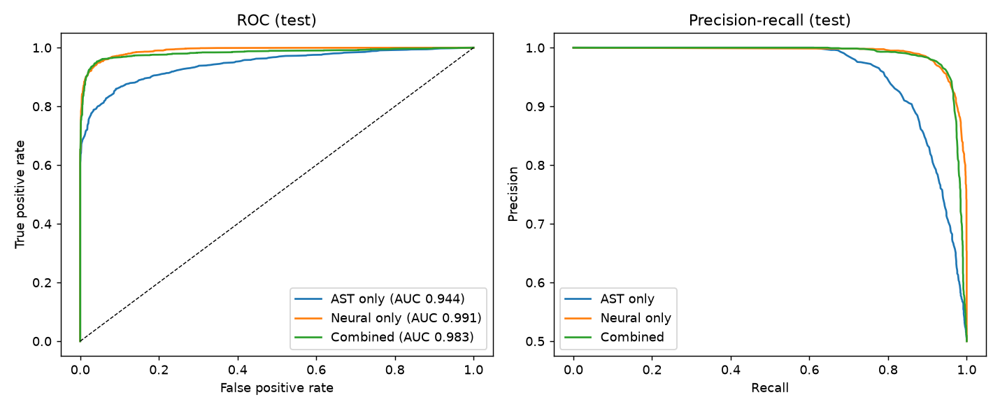
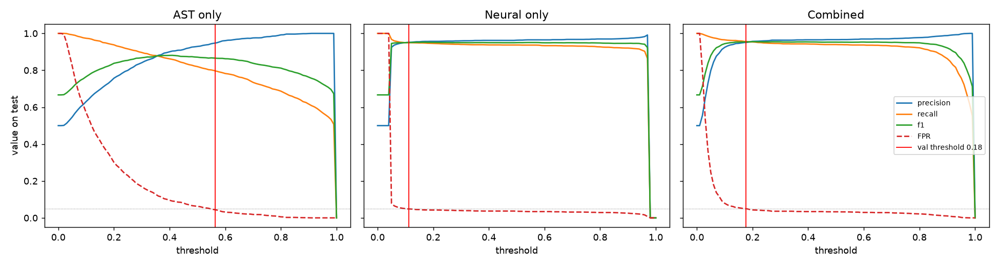
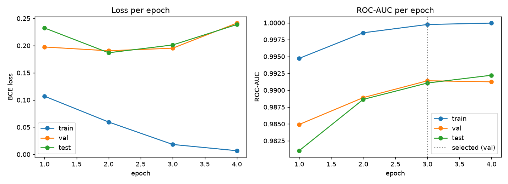
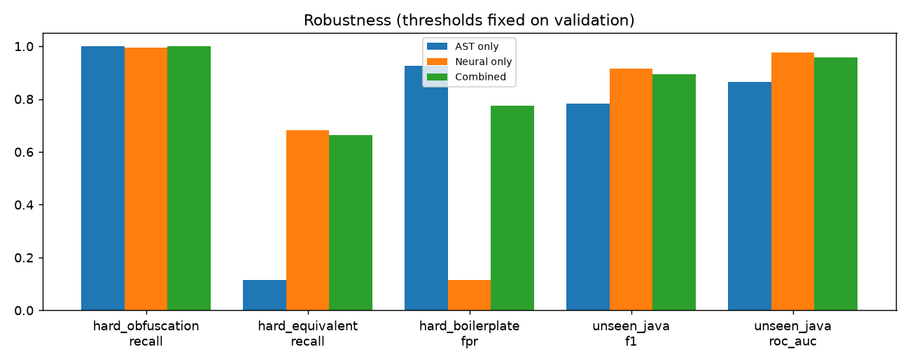
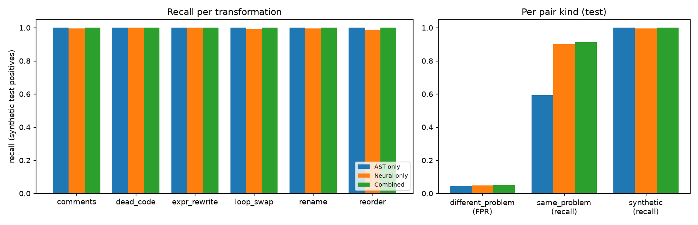
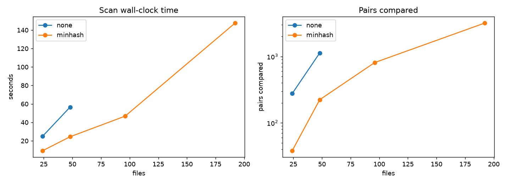

# CodePlag · Detección de similitud entre programas

## Parte 1: Presentación del Dataset y del Modelo Desarrollado

### 1. Selección del Dataset

Usamos **Python800 de IBM Project CodeNet** como conjunto principal. Contiene soluciones
aceptadas por jueces en línea. La estructura por problema permite construir pares con la
misma tarea y reservar problemas completos para medir generalización. El espejo de descarga
declara Apache 2.0, la misma licencia publicada por el repositorio de IBM. Los conteos de
este informe salen de los archivos de la corrida. [Project CodeNet](https://github.com/IBM/Project_CodeNet) · [Licencia](https://github.com/IBM/Project_CodeNet/blob/main/LICENSE) · [Espejo de datos](https://huggingface.co/datasets/qiankunmu/Project_CodeNet_Python800_and_Java250) · [Estadísticas registradas](../results/dataset_stats.json)

| Corpus | Uso posible | Razón de la elección |
| --- | --- | --- |
| CodeNet | Comparar programas completos agrupados por problema | Python800 cubre el lenguaje principal y Java250 permite una prueba de transferencia con el mismo esquema de datos. |
| POJ-104 | Comparar soluciones a un mismo problema | Se centra en C/C++, lenguajes fuera del alcance actual del analizador sintáctico. |
| BigCloneBench | Comparar fragmentos Java con anotaciones de clonación | Sus casos servirían para validar fragmentos de proyectos Java. La evaluación inicial estudia entregas completas en Python. |
| SOCO | Detectar reutilización de código con anotaciones humanas | Su tarea se acerca a la aplicación educativa. CodeNet ofrece una partición por problema y una prueba en otro lenguaje dentro del mismo corpus. |

[CodeXGLUE](https://microsoft.github.io/CodeXGLUE/) · [BigCloneBench](https://github.com/clonebench/BigCloneBench) · [SOCO](https://pan.webis.de/fire14/pan14-web/)

Python800 contiene **240 000 archivos en 800 problemas**. Se descartaron 11 677 archivos con
menos de tres líneas no vacías, 4 051 que no se pudieron analizar como Python 3,
393 duplicados exactos y 76 de más de 6 000 bytes. Quedaron 223 803 candidatos. Se muestrearon
40 por problema para un total de 32 000 archivos. La mediana de la muestra fue de 12 líneas
y 251 bytes. Java250 contiene 75 000 archivos en 250 problemas. Para transferencia se
cargaron 100 problemas, quedaron 29 853 archivos tras filtrar y se muestrearon 4 000.
[Conteos del preprocesamiento](../results/dataset_stats.json)

| Partición Python | Problemas | Pares | Mismo problema | Sintéticos | Distinto problema |
| --- | ---: | ---: | ---: | ---: | ---: |
| Entrenamiento | 560 | 24 000 | 6 000 | 6 000 | 12 000 |
| Validación | 120 | 4 000 | 1 000 | 1 000 | 2 000 |
| Prueba | 120 | 4 000 | 1 000 | 1 000 | 2 000 |

Cada fila de los JSONL procesados tiene 11 campos. `id` y `split` identifican el par y su
partición. `label` indica la clase binaria y `kind` su origen. `lang_a` y `lang_b` registran
el lenguaje, `file_a` y `file_b` la procedencia y `code_a` y `code_b` el texto de ambos
programas. `transforms` lista las transformaciones aplicadas.

Se separaron los problemas antes de construir los pares, con semilla 42. Cada partición
combina como positivos dos soluciones aceptadas al mismo problema y variantes sintéticas.
Los negativos ordinarios cruzan problemas distintos. Para Python se aplican cambios de
nombres y comentarios, reordenamiento conservador, inserción de código inalcanzable,
intercambio de bucles y reescritura de expresiones cuando las reglas aplican. Las etiquetas
representan similitud funcional o reutilización simulada. Un par de soluciones al mismo
problema puede provenir de dos autores que trabajaron de forma independiente.

Al regenerar el corpus desde los dos archivos de CodeNet se obtuvieron los mismos
archivos de pares, particiones y estadísticas, comprobados por SHA-256.

### 2. Modelo Desarrollado y Resultados

El detector estructural usa tree-sitter para Python, Java y JavaScript. Normaliza
comentarios, docstrings, nombres, literales y ciertas construcciones. Calcula tres rasgos
complementarios: similitud por distancia de edición Zhang–Shasha, coincidencia de hashes de
subárboles y coincidencia de trigramas de etiquetas. La distancia usa la estructura
anotada de `zss` y poda árboles que exceden 250 nodos. El informe muestra rangos de líneas
de los subárboles compartidos.

La red siamesa usa PyTorch y Transformers con el codificador compartido UniXcoder. Promedia
las representaciones de los tokens efectivos, las proyecta a 256 dimensiones y produce un
puntaje con un perceptrón multicapa simétrico. Se truncó a 256 tokens, se congelaron las
representaciones de entrada y seis capas inferiores, y se entrenó con entropía cruzada
binaria y AdamW. La corrida registrada usó CUDA, cuatro épocas y los 24 000 pares de
entrenamiento. Duró 52,4 minutos. El ROC-AUC de validación seleccionó la época 3.
[UniXcoder](https://aclanthology.org/2022.acl-long.499/) · [Historial de entrenamiento](../results/training_history.json)

El combinador usa regresión logística sobre los tres rasgos del árbol y el puntaje
neuronal. Los detectores de referencia también se ajustaron en validación, cada uno con
sus propias señales. Para cada detector se fijó el umbral con una tasa de falsos positivos
(FPR) de hasta 5 % en validación. Los umbrales se aplicaron a prueba y a los conjuntos de
robustez. Docker proporciona un entorno CPU para ejecutar el CLI.

#### Resultados en Python800

La prueba reúne 4 000 pares. Los umbrales de la tabla se fijaron en validación con un
límite de 5 % de falsos positivos. PR-AUC se calculó como precisión promedio.

| Detector | Umbral | Exactitud | Precisión | Sensibilidad | F1 | FPR | ROC-AUC | PR-AUC |
| --- | ---: | ---: | ---: | ---: | ---: | ---: | ---: | ---: |
| AST | 0,56432 | 87,65 % | 94,82 % | 79,65 % | 0,8658 | 4,35 % | 0,9443 | 0,9569 |
| Neuronal | 0,11233 | 95,05 % | 95,14 % | 94,95 % | 0,9505 | 4,85 % | 0,9911 | 0,9917 |
| Combinado | 0,17657 | 95,35 % | 95,08 % | 95,65 % | 0,9536 | 4,95 % | 0,9829 | 0,9873 |

| Detector | Verdaderos negativos | Falsos positivos | Falsos negativos | Verdaderos positivos |
| --- | ---: | ---: | ---: | ---: |
| AST | 1 913 | 87 | 407 | 1 593 |
| Neuronal | 1 903 | 97 | 101 | 1 899 |
| Combinado | 1 901 | 99 | 87 | 1 913 |

El combinado recuperó 14 positivos más que la red sola y marcó dos negativos
adicionales. La red sola obtuvo el ROC-AUC y PR-AUC más altos, así que ordenó
mejor el conjunto en el rango completo de puntajes. [Métricas y matrices](../results/metrics.json)

El umbral combinado de 0,17657 produjo una FPR de 4,90 % en validación y 4,95 % en
prueba. Otro punto operativo, seleccionado para maximizar F1 en validación
(`0,26330`), produjo una FPR de 3,75 % y una sensibilidad de 94,65 % en prueba.
En conteos, fueron 24 falsos positivos menos y 20 falsos negativos más. La curva
de prueba permite visualizar ese intercambio. [Barrido de umbrales](../results/threshold_analysis.csv)





#### Generalización durante el entrenamiento

| Época | Pérdida entrenamiento | Pérdida validación | Pérdida prueba | ROC-AUC entrenamiento | ROC-AUC validación | ROC-AUC prueba |
| ---: | ---: | ---: | ---: | ---: | ---: | ---: |
| 1 | 0,1070 | 0,1975 | 0,2325 | 0,9947 | 0,9849 | 0,9810 |
| 2 | 0,0595 | 0,1905 | 0,1869 | 0,9985 | 0,9889 | 0,9886 |
| 3 | 0,0182 | 0,1953 | 0,2012 | 0,9998 | 0,9914 | 0,9911 |
| 4 | 0,0068 | 0,2414 | 0,2388 | 0,99996 | 0,9913 | 0,9922 |

La pérdida se midió sobre 2 000 pares de entrenamiento y 4 000 en cada uno de los otros
conjuntos. La pérdida de entrenamiento siguió bajando mientras la de validación subió
después de la segunda época. Esa diferencia sugiere sobreajuste y mayor confianza en
errores. El historial registró las curvas de prueba; la elección de la época se basó en
validación. En la época elegida, el modelo neuronal produjo en prueba un F1 de 0,9505 y
una FPR de 3,40 % con el umbral directo de 0,5. El ajuste posterior de la regresión
logística usa un umbral de validación propio. [Historial](../results/training_history.json)



## Parte 3: Evaluación del Modelo y Viabilidad Comercial

### 1. Revisión del Modelo Desarrollado

#### Robustez

| Prueba | Pares | Métrica | AST | Neuronal | Combinado |
| --- | ---: | --- | ---: | ---: | ---: |
| Ofuscación de varias transformaciones | 500 | Sensibilidad | 100 % | 99,6 % | 100 % |
| Mismo problema y bajo parecido léxico | 500 | Sensibilidad | 11,4 % | 68,2 % | 66,4 % |
| Problemas distintos con plantilla compartida | 500 | FPR | 92,6 % | 11,4 % | 77,6 % |
| Java250 | 2 000 | F1 | 0,7821 | 0,9149 | 0,8946 |
| Java250 | 2 000 | FPR | 24,9 % | 10,3 % | 16,4 % |

Los tres primeros grupos contienen una sola clase. Se muestra sensibilidad para
los positivos y FPR para los negativos. En Java, el combinado recuperó 94,2 % de
los positivos y marcó 164 de 1 000 negativos. La red sola obtuvo el F1 más alto en
Java y registró 57 falsos positivos en el grupo de plantillas, frente a 388 del
combinado. [Resultados de robustez](../results/robustness.json)

En la prueba principal, el combinado detectó el 100 % de los pares sintéticos y el
91,3 % de las soluciones al mismo problema. El AST alcanzó 59,3 % en este último
grupo. Los seis tipos de transformación registraron 100 % de sensibilidad con el
combinado. Para la red sola, los resultados por transformación variaron entre
98,9 % en reordenamiento y 100 % en inserción de código muerto y reescritura de
expresiones. Algunas variantes incluyen más de una transformación.
[Resultados por tipo de par](../results/per_kind.csv) · [Resultados por transformación](../results/per_transform.csv)





#### Límites del experimento

CodeNet representa programas de concurso, en general cortos y de un solo archivo. El
balance de clases de la prueba es artificial. Con una prevalencia menor de reutilización,
la proporción de alertas correctas puede bajar aunque se mantenga la misma FPR. Los
negativos se definen principalmente por problemas distintos, por lo que faltan ejemplos
anotados de soluciones independientes al mismo ejercicio. También faltan entregas reales,
proyectos de varios archivos y ejemplos identificados como código generado por IA.
Plantillas compartidas, algoritmos obvios y código generado a partir de enunciados
similares pueden producir coincidencias altas.

La poda reduce lo que observa la distancia de edición en árboles grandes y el límite de
256 tokens puede omitir las diferencias que aparecen al final del archivo. La prueba de
Java mide transferencia a un lenguaje ausente del ajuste supervisado. De los 100
problemas de Java, 71 también aparecen en el entrenamiento de Python. UniXcoder tuvo
preentrenamiento multilingüe. JavaScript cuenta con soporte sintáctico y queda fuera de
esta evaluación.

#### Áreas de mejora

1. Construir un conjunto de prueba con revisión humana que incluya entregas independientes
   del mismo ejercicio, código inicial compartido y casos confirmados de reutilización.
   Reservar cursos completos y medir FPR y precisión bajo las tasas de incidencia observadas.
2. Medir el aporte de cada señal sobre plantillas y código largo, descontar los fragmentos
   entregados por el docente y probar ventanas de tokens antes de recalibrar por lenguaje.
3. Medir la recuperación de candidatos y el coste de escaneo en lotes mayores. Ajustar
   MinHash o combinarlo con vecinos por embeddings si el filtrado pierde coincidencias
   relevantes.

### 2. Viabilidad Comercial del Modelo

#### Desempeño y uso

El uso razonable es un piloto para priorizar pares para revisión por docentes. El reporte
permite inspeccionar los rangos coincidentes y consultar las señales que aportan al
puntaje. El F1 de 0,9536 en Python es suficiente para estudiar ese uso asistido. La FPR
de 77,6 % con plantillas compartidas impide recomendar la decisión automática. Un revisor
necesita considerar el enunciado, el código inicial, los cambios y la
explicación de quienes entregaron. Antes de una sanción se requiere revisión humana
documentada y una oportunidad de aclaración. Se necesita validación con el contexto y
las tasas de incidencia de la institución para justificar un uso comercial más amplio.

#### Escalabilidad y despliegue

El escaneo exhaustivo compara `n(n − 1)/2` pares. El escaneo con MinHash agrupa firmas
del árbol normalizado y aplica la comparación completa a los candidatos. El costo aún
puede acercarse al exhaustivo si muchos archivos comparten plantillas. El sistema
reutiliza embeddings dentro de un escaneo y distribuye las comparaciones AST en procesos.
La imagen Docker de CPU se construyó y ejecutó con el par de ejemplo, incluyendo la
carga del checkpoint local.

Las mediciones se hicieron en Windows 11 en un Intel Core i7-12650H con 31,7 GiB
de RAM y una GPU integrada Intel UHD. En 200 pares, el AST tardó 144,1 ms de
media y 480,2 ms en el percentil 95. En 100 pares sin embeddings reutilizados,
el componente neuronal tardó 117,3 ms de media y 179,0 ms en el percentil 95.
En el lote de 1 000 pares, el componente neuronal procesó 8,99 pares por segundo.
La memoria residente del proceso principal fue de 2 903,1 MiB al iniciar la
medición, 3 361,6 MiB antes del escaneo y 3 436,7 MiB al terminar. Son lecturas
del proceso principal en esos instantes. [Mediciones de eficiencia](../results/efficiency.json)

| Archivos | Modo de escaneo | Candidatos / pares posibles | Tiempo (s) | Archivos por segundo |
| ---: | --- | ---: | ---: | ---: |
| 24 | Exhaustivo | 276 / 276 | 24,98 | 0,96 |
| 24 | MinHash | 38 / 276 | 9,28 | 2,59 |
| 48 | Exhaustivo | 1 128 / 1 128 | 56,60 | 0,85 |
| 48 | MinHash | 223 / 1 128 | 24,42 | 1,97 |
| 96 | MinHash | 809 / 4 560 | 46,72 | 2,06 |
| 192 | MinHash | 3 183 / 18 336 | 147,56 | 1,30 |

En los lotes de 24 y 48 archivos, MinHash redujo el tiempo medido frente al
escaneo exhaustivo. Con 192 archivos redujo 82,6 % de las comparaciones posibles.
El filtro conservó todos los vínculos sintéticos conocidos en los cuatro tamaños.
Cada lote se construyó con originales y variantes de la prueba, por lo que la
retención observada se refiere a esos vínculos.



#### Privacidad, licencias y explicabilidad

Una entrega vinculada con nombre, matrícula, repositorio o comentarios identificables
puede incluir datos personales. Para un piloto institucional, el equipo debe limitar
el acceso, usar identificadores de expediente, proteger archivos y resultados, definir
plazos de borrado y explicar a estudiantes el propósito del tratamiento y la forma de
corregir o controvertir un resultado. Si aplica el GDPR, la institución debe determinar la
base jurídica y documentar finalidad, minimización, conservación y transparencia. El
artículo 22 exige revisar el caso de decisiones basadas únicamente en tratamiento
automatizado con efectos jurídicos o de importancia similar. En México, el régimen
depende del tipo de institución. Para particulares, la LFPDPPP regula aviso de privacidad,
tratamiento, seguridad y derechos ARCO. [GDPR](https://eur-lex.europa.eu/eli/reg/2016/679/oj/eng/) · [LFPDPPP vigente](https://www.diputados.gob.mx/LeyesBiblio/pdf/LFPDPPP.pdf)

CodePlag se distribuye bajo MIT. CodeNet y el espejo indican Apache 2.0. Antes de ofrecer
un producto, un abogado debe verificar las condiciones aplicables a entregas originales,
dependencias, pesos de UniXcoder y redistribución de datos y artefactos, además del régimen
de privacidad, la base jurídica, los avisos, las transferencias y el procedimiento ante
una impugnación. [Licencia de CodePlag](../../LICENSE) · [Licencia de CodeNet](https://github.com/IBM/Project_CodeNet/blob/main/LICENSE) · [UniXcoder](https://huggingface.co/microsoft/unixcoder-base)

#### Reproducción

Ejecutar desde la raíz del repositorio con Python 3.12 y las dependencias instaladas. El
entrenamiento de referencia requiere PyTorch con CUDA. Para la evaluación se usó el
checkpoint de la época 3, OpenVINO 2026.4.1 en FP32 en la GPU integrada Intel UHD y cuatro
procesos para las comparaciones de AST. La cabeza de la red siguió en PyTorch sobre CPU.
En una comprobación con pares de prueba, la máxima diferencia absoluta entre embeddings
de PyTorch y de OpenVINO en GPU fue de 0,000035. Esa comprobación mide equivalencia numérica
en la muestra. [Conversión del modelo con OpenVINO](https://docs.openvino.ai/nightly/openvino-workflow/model-preparation/convert-model-pytorch.html)

```bash
codeplag prepare-data
codeplag train --device cuda
pip install -e ".[openvino]"
export CODEPLAG_OPENVINO_DEVICE=GPU OMP_NUM_THREADS=2 MKL_NUM_THREADS=2
codeplag evaluate --device cpu --workers 4
codeplag plots
```

En PowerShell se asignan esas tres variables con `$env:CODEPLAG_OPENVINO_DEVICE='GPU'`,
`$env:OMP_NUM_THREADS='2'` y `$env:MKL_NUM_THREADS='2'`. Se puede usar el motor de PyTorch
en CPU omitiendo `CODEPLAG_OPENVINO_DEVICE`.

Los archivos procesados y los pesos se generan localmente. La guía de instalación
incluye una variante de entrenamiento con menos pares para CPU. [Guía de ejecución](../usage/quickstart.md) · [Versiones y huellas SHA-256](../results/provenance.json)
